<div align="center">



<br/>


<br/>


</div>

---

<h2 align="center"><code>WHOAMI</code></h2>

```bash
> INITIALIZING SYSTEM...
[OK] Loading profile: Adryan Silva Santos
[OK] Role: Data & Automation Analyst
[OK] Base: Instituto Maria Schmitt (IMAS) — healthcare
[OK] Education: Systems Analysis & Development @ Infnet
[OK] Objective: Transforming manual processes into automated, data-driven systems
[INFO] Specializing in healthcare data operations and business intelligence
[INFO] Next quest: Data Engineering
```

<h2 align="center"><code>TECH ARSENAL</code></h2>

<div align="center">


<br/>


</div>

<h2 align="center"><code>GITHUB METRICS</code></h2>

<div align="center">


</div>

<h2 align="center"><code>ACTIVITY LOG</code></h2>

<div align="center">


</div>

<h2 align="center"><code>OPERATIONAL MODULES</code></h2>

<table align="center">
<tr>
<td align="center" width="25%">

**🧠 Data Engine**
<br/>
Scheduling data pipeline
<br/>
Divergence detection
<br/>
Automated reports

</td>
<td align="center" width="25%">

**⚙️ Automation Bot**
<br/>
Python + Apps Script
<br/>
Hospital routines
<br/>
Sheets workflows

</td>
<td align="center" width="25%">

**📈 BI Interface**
<br/>
Satisfaction dashboards
<br/>
Budget tracking
<br/>
Supply price monitoring

</td>
<td align="center" width="25%">

**🏗️ Backend Build**
<br/>
Asset management system
<br/>
~70 hospital units
<br/>
FastAPI · PostgreSQL · Docker

</td>
</tr>
</table>

<p align="center"><sub>Built in a professional environment at IMAS — code and data are internal.</sub></p>

<h2 align="center"><code>CURRENT QUESTS</code></h2>

```bash
> LOADING CURRENT QUESTS...
[RUNNING] Asset management system — FastAPI · PostgreSQL · Docker
[RUNNING] Studying Data Engineering — pipelines & databases
[NEXT]    SUS Hospital Analytics — expand from Santa Catarina to all of Brazil
```

<h2 align="center"><code>FEATURED PROJECTS</code></h2>

<div align="center">

<a href="https://github.com/AdryanSilva1/sus-hospital-analytics"></a>
<a href="https://github.com/AdryanSilva1/ads-infnet"></a>
<a href="https://github.com/AdryanSilva1/automacao-relatorios-vendas"></a>
<a href="https://github.com/AdryanSilva1/python-estudos"></a>

</div>

<h2 align="center"><code>CONTRIBUTION GRID</code></h2>

<div align="center">

<picture>
  <source media="(prefers-color-scheme: dark)" srcset="https://raw.githubusercontent.com/AdryanSilva1/AdryanSilva1/output/pacman-contribution-graph-dark.svg" />
  <source media="(prefers-color-scheme: light)" srcset="https://raw.githubusercontent.com/AdryanSilva1/AdryanSilva1/output/pacman-contribution-graph.svg" />
  
</picture>

</div>

<h2 align="center"><code>ESTABLISH CONNECTION</code></h2>

<div align="center">

<a href="https://www.linkedin.com/in/adryan-silva-santos">

</a>

<a href="mailto:adryandasilvasantos12@gmail.com">

</a>

</div>

<div align="center">

```bash
[SYSTEM] Building one project at a time...
```


</div>
